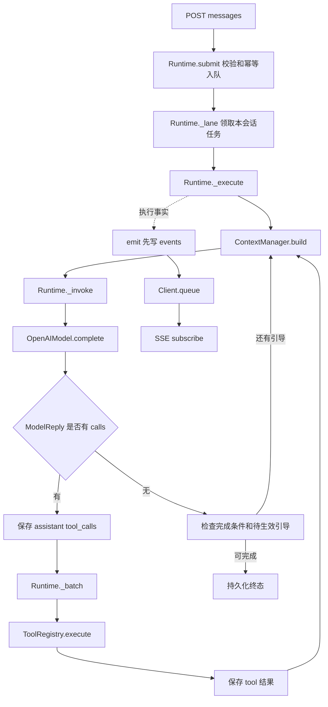
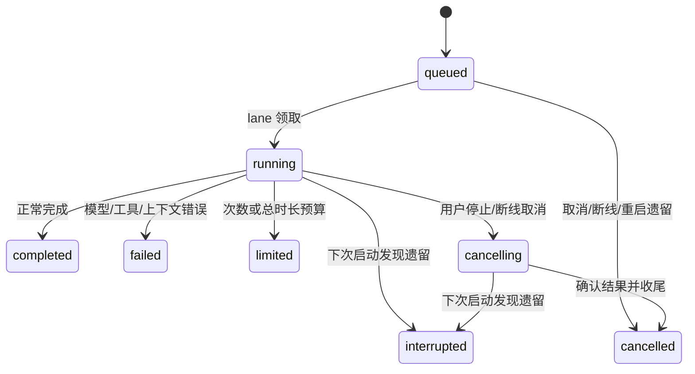

# 三天深入理解 Agent Harness：后端学习与代码导读

编写日期：2026-10-20。面向毛毛，代码基线为 `df7ceee`；行号按该版本核对。后续代码变化时优先搜索函数名，不能只记行号。

项目根目录：`D:\MyProject\guangcheng_agent_harness`。本路线约 90% 聚焦后端，前端仅用于解释请求、SSE 和窗口状态。预计每天 **8 小时有效学习**，休息另计。三天的目标是能独立追踪请求、解释机制、借助测试定位问题，并说明实现边界。

配套 [后端源码与测试符号索引](backend_source_index.md) 列出全部后端类、函数、嵌套辅助函数及测试的起止行号。学习顺序以本路线为准，索引用于精确定位，不必从索引第一行开始机械通读。

本文件是学习指导，不是要求现在运行真实模型。编写时只读源码并生成文档，没有启动服务、执行测试或发起模型请求。文中测试命令供学习时自行选择执行；先使用临时 SQLite 和显式假模型，不需要真实 API Key。

## 0. 三天后必须能交付什么

完成以下六份学习成果，才算走完路线；不以“看完文件”代替理解。

1. 一张请求时序图：HTTP 接收、入队、调度、模型调用、工具执行、历史保存、事件通知、任务结束。
2. 一张状态与归属图：User、Client、Session、Run、Message、Steering、Todo、Operation、Event、Summary。
3. 三份执行台账：直接回答、计算并写待办、摘要压缩；每一步标出函数、输入、输出和持久化位置。
4. 一份异常矩阵：重试、部分输出失败、工具失败、预算不足、停止、断线、重启、压缩失败。
5. 一份测试说明：至少能解释 12 个关键测试的准备、动作、断言、证明范围与未证明范围。
6. 一次 20 分钟讲解：不用 AI 代答，解释为什么这是自行实现的 Agent Runtime，以及它尚不能保证什么。

学习方法：每个代码块依次完成“先预测行为 → 看代码 → 画数据变化 → 用测试核对 → 脱离代码复述”。看不懂某个库调用时，只补足理解当前分支需要的知识，不先通读整个框架。

## 1. 最最核心的文件与函数

### 1.1 必须精读的九个位置

| 顺序 | 位置 | 负责什么 | 必须回答的问题 |
| --- | --- | --- | --- |
| 1 | [runtime.py:450](../backend/app/runtime.py)，`Runtime._execute`，450–569 行 | Agent 主循环和终态收尾 | 为什么需要反复调用模型？什么时候执行工具，什么时候完成？ |
| 2 | [runtime.py:153](../backend/app/runtime.py)，`submit`，153–187 行；`_lane`，287–314 行 | 请求入队、同会话串行调度 | 为什么请求返回后任务还能继续？两个会话如何并行？ |
| 3 | [llm.py:27](../backend/app/llm.py)，`OpenAIModel.complete`，27–117 行 | 模型协议适配、流式拼接 | 模型怎样表达工具调用？为什么不能收到一段参数就执行？ |
| 4 | [runtime.py:583](../backend/app/runtime.py)，`_batch`，583–695 行 | 一批工具的预算、并发、结果和取消 | 为什么 todo 批次串行？取消后已提交的写入怎么办？ |
| 5 | [context.py:60](../backend/app/context.py)，`ContextManager.build`，60–253 行 | 组装输入、选择历史、生成摘要 | 数据库历史与真正发给模型的输入有什么区别？ |
| 6 | [tools.py:175](../backend/app/tools.py)，`todo`，175–226 行 | 用户共享待办、事务、幂等、版本校验 | 重试为什么不会重复写？两个窗口同时编辑如何处理？ |
| 7 | [runtime.py:341](../backend/app/runtime.py)，`_invoke`，341–417 行 | 模型调用预算、重试、流式事件 | 为什么关闭 SDK 重试？为什么已有部分输出不重试？ |
| 8 | [runtime.py:258](../backend/app/runtime.py)，`_cancel_locked`，258–267 行；`disconnect`，269–285 行；`repair_calls`，697–727 行 | 停止、断线与协议恢复 | 为什么停止不是简单把状态改成 cancelled？ |
| 9 | [storage.py:54](../backend/app/storage.py)，`transaction`，54–57 行；`put`，66–85 行；`append_event`，102–124 行 | 持久化边界 | 哪些数据必须一起提交？为什么事件先落库再发送？ |

如果时间暂时只够一小时，先读 `_execute`，遇到 `_invoke`、`context.build`、`_batch` 时只标记调用关系，不立即深入。第二遍再逐个进入，避免在长函数中失去主线。

### 1.2 文件职责与完整阅读优先级

| 优先级 | 文件 | 当前规模 | 阅读要求 |
| --- | --- | --- | --- |
| P0 | [runtime.py](../backend/app/runtime.py) | 734 行 | 全部阅读；主循环、调度、工具批次、取消至少两遍 |
| P0 | [context.py](../backend/app/context.py) | 253 行 | 全部阅读；逐分支推演 build |
| P0 | [llm.py](../backend/app/llm.py) | 179 行 | 全部阅读；重点流式聚合、错误分类、ScriptedModel |
| P0 | [tools.py](../backend/app/tools.py) | 226 行 | 全部阅读；重点注册契约与 todo 事务 |
| P1 | [storage.py](../backend/app/storage.py) | 149 行 | 全部阅读；理解统一记录表与事件表 |
| P1 | [schemas.py](../backend/app/schemas.py) | 123 行 | 先看类型，再随业务回查校验条件 |
| P1 | [main.py](../backend/app/main.py) | 266 行 | 先入口、消息、SSE，再看模型／设置 CRUD |
| P1 | [token_budget.py](../backend/app/token_budget.py) | 5 行 | 全部阅读；只做输入空间预留，没有摘要长度目标 |
| P1 | [tests](../backend/tests) | 按功能分文件 | 和业务成对阅读，不留到最后才看 |
| P2 | [pyproject.toml](../backend/pyproject.toml)、[uv.lock](../backend/uv.lock)、[.python-version](../backend/.python-version) | 环境与依赖 | 会解释依赖用途；不用逐行阅读 lock |
| P2 | [quick-start](../backend/scripts-dev/quick-start/start.ps1) | 本地运行入口 | 能识别工作目录、端口、解释器与运行版本问题即可 |

## 2. 先建立正确的概念与数据地图

### 2.1 本项目究竟实现了什么

题目要求的主流程是“接收输入 → 模型选择回答或工具 → 本地执行工具 → 把结果交回模型 → 继续或完成”。这里没有使用 Agent 框架代管该循环。

- FastAPI：提供 HTTP、参数注入、生命周期和 StreamingResponse。
- OpenAI SDK／httpx：发送兼容协议请求与接收响应，不替项目执行 todo。
- Pydantic：定义输入契约、生成工具 Schema、校验模型生成的工具参数。
- SQLAlchemy／aiosqlite：异步访问 SQLite，保存记录和事件。
- asyncio：任务、取消、锁、队列、超时和并发工具的调度基础。
- tiktoken：能匹配模型时估算 token；匹配失败有保守回退。

“ReAct”可以用于理解反复观察工具结果再决策的形态，但本项目主要读取公开正文和 Function Calling 字段，不提取或展示模型隐藏思维链。System 1／2 是讨论快慢思考时的类比，这里没有两套对应实现；没有额外 Jev 或 Decisions API 路由。

### 2.2 十种对象必须分清

| 对象 | 身份／归属 | 是否持久化 | 在哪里创建／使用 | 容易混淆的地方 |
| --- | --- | --- | --- | --- |
| User | A／B 演示用户 | 用户记录在数据库 | `initialize`、`main.user` | Header 演示身份不是生产认证 |
| Client | 一个窗口的事件连接身份 | 对象在 Runtime 内存；run 保存 client_id | `register_client`、`Client` | 不等于 Session，断线取消按 client_id 筛选 |
| Session | 一条会话历史的边界 | records，kind=session | `create_session`、`session` | 同用户不同会话历史隔离 |
| Run | 一次普通任务或手动压缩任务 | records，kind=run | `submit`、`_lane` | 同一个 Session 可以有多个历史和排队 Run |
| Message | user／assistant／tool 协议消息及元数据 | records，kind=message，parent=session_id | `append` | 不是每个 SSE delta 都是一条完整消息 |
| Steering | 某个 Run 的补充条件 | records，kind=steering，parent=run_id | `steer`、`_apply_steering` | 不自动成为新的独立 Run |
| Todo | 当前用户共享业务待办 | records，kind=todo，owner=user_id | `tools.todo` | 跨会话共享不等于自动把全部内容放进 prompt |
| Operation | 已提交写入的操作证据 | records，kind=operation | `tools.todo`、`repair_calls` | 幂等结果与聊天摘要作用不同 |
| Event | 可观察的执行事实 | events 表，另发送到 Client.queue | `emit`、`append_event` | 事件流不是模型输入历史 |
| Summary | 一条会话的历史摘要及覆盖 ID | records，kind=summary | `ContextManager.build` | 只是模型输入的一部分，不是完整上下文 |

还有两种全局记录：profile 保存模型连接与测试信息，settings 保存运行配置。同一用户跨窗口的 Todo 与 Session 的归属规则不同；模型设置在首版是全局共享配置，不是多租户隔离的配置中心。

### 2.3 数据流图：第一天必须默画



注意：POST 返回一个 Run，不是同步等待最终回答。图中事件箭头是旁路观测，不能把它和模型—工具协议循环混成一条链。

## 3. 三天总安排

时间是有效学习时长。每个 60–90 分钟学习块结束后休息 10–15 分钟；不要为了赶表跳过验收。

| 天数 | 核心目标 | 时间分配 | 当天通过标准 |
| --- | --- | --- | --- |
| 第一天 | 走通正常请求、模型协议和工具循环 | 45 + 60 + 75 + 90 + 75 + 75 + 60 = 480 分钟 | 能逐步推演“计算 128×36 并记入待办”，解释每条协议消息 |
| 第二天 | 理解状态、事务、并发与故障处理 | 60 + 75 + 60 + 75 + 90 + 75 + 45 = 480 分钟 | 能解释停止／断线／重启差别，写出有证据的异常矩阵 |
| 第三天 | 深入 Context、压缩、测试和面试讲解 | 75 + 90 + 75 + 45 + 75 + 60 + 60 = 480 分钟 | 能解释压缩覆盖边界、真实 bug 根因和项目能力边界 |

每天末尾如果不能通过验收，次日第一块先补薄弱点，缩减后续重复阅读。不要把没有理解的部分打勾。

## 4. 第一天：从输入到答案，走通完整 Agent 循环

### D1-1｜45 分钟：题目、环境与工程入口

**阅读顺序**：原题 Vibe coding 部分 → [requirements.md](requirements.md) → [pyproject.toml](../backend/pyproject.toml) → `main.py` 37–50、263–266 行。

重点看 `create_app(database_path=None, model=None)`：数据库路径可注入，模型也可注入；默认数据库在 backend/.data，lifespan 初始化并最终关闭 Runtime，模块底部创建 app。测试并不一定需要启动 uvicorn。

做三件事：列出题目的“必须”与“扩展”；把每个依赖对应到一个真实用途；标出 API／Runtime／模型适配／工具／存储五个边界。

**提交物**：一页“项目能做什么”说明，最多 12 项；其中每项都对应到一个源码文件。

**验收**：SDK 为什么不算 Agent 框架？直接运行 runtime.py 为什么不是正确服务入口？为什么配置模型的保存操作可能调用真实 API，而阅读代码不会？

### D1-2｜60 分钟：先认识协议与数据库，不背所有字段

**阅读顺序**：`schemas.py` 8–38、60–113 行 → `storage.py` 13–33、54–96 行 → `tools.py` 175–226 行只看读写字段。

重点理解：

1. StrictModel 拒绝额外字段；MessageRequest／SteeringRequest／ToolCall／ModelReply 各自处于不同边界。
2. `ToolCall.arguments` 是 JSON 字符串，尚不是 CalculatorArgs 或 TodoArgs。
3. records 用 kind／owner／parent 分类与过滤，不是一张独立的 todo ORM 表。
4. records.data 是 JSON 负载；put 更新已有记录时只更新 data，不重新赋值其外层 owner／parent。
5. `Database.transaction` 提供一把数据库写锁和一次提交边界；在已有事务中传入 connection，避免再次独立开事务。

**纸上练习**：画一个 A 用户、两个 Session、三个 Run、两个共享 Todo 的关系图；分别写出 list(message, parent=...) 与 list(todo, owner=...) 的过滤条件。

**提交物**：对象关系图、至少 5 个标识符用途说明。

**验收**：同用户两个会话为什么能共享待办又互不继承聊天？把所有读取都写成 db.get(id) 是否足够保证用户隔离？谁负责归属检查？

### D1-3｜75 分钟：接收请求、幂等入队与 Session Lane

**阅读顺序**：`main.py` 85–88、91–118、157–158 行 → `runtime.py` 101–110、123–139、153–187、287–314 行。

将 submit 拆成八步：会话归属校验 → Client 连通与用户校验 → 构造 request_key → 查已有 Run → 检查手动压缩互斥条件 → 检查模型配置 → 事务保存 run 与 request → 通知并创建 lane。

将 `_lane` 拆成六步：在 control 锁内取第一条 queued → 检查 Client → 改 running → 登记 active → 创建 `_execute` Task → 在锁外等待并清理。

关键结论：数据库中的 queued 记录承担待执行任务保存；`Client.queue` 是事件队列，二者不是一回事。每个 Session 一条 lane；control 是全 Runtime 的控制锁，但模型执行不长期占用它，所以其他会话仍能推进。

**测试对照**：`test_runtime.py` 68–78 行的 `test_direct_reply_and_request_deduplication`；29–65 行的 harness／send／terminal 先读一遍。

**断点**：`submit` 请求去重处、`_lane` 改 running 处。观察 request_id、client_id、session_id、run.id、lanes、executions、active。

**提交物**：入队时序图；两次相同 request_id、两次不同 request_id 各会创建几个 Run 的预测表。

**验收**：为什么不能在 control 锁内 await 整个模型调用？HTTP 200 返回的究竟是什么？同一 Session 的两个 Client 是否仍共享同一条 lane？

### D1-4｜90 分钟：精读最核心的 `_execute`

**阅读范围**：`runtime.py` 450–569 行。先只看正常路径，再看 except／finally。

| 区间 | 读到的步骤 | 观察变量 |
| --- | --- | --- |
| 450–463 | 设置与对话／摘要模型快照 | settings、profile、summary_profile、model_snapshot |
| 464–468 | 保存用户输入；手动压缩分流 | purpose、input_kind、run.content |
| 469–493 | 总时长、循环、引导、构建上下文 | messages、当前 Run、待生效 steering |
| 494–513 | 调用模型、检查重复工具 ID | reply、ids、previous_calls |
| 514–528 | 构造并保存 assistant 消息，执行工具后继续 | reply.calls、message、模型调用次数 |
| 529–544 | 正常结束条件与最后一次引导检查 | finish_reason、text、pending、status |
| 545–569 | 取消、预算、失败、协议修复与终态持久化 | reason、partial、ended_at |

先用口头伪代码复述：

```text
为当前 Run 固定配置
保存用户请求
循环：应用引导 → 组装消息 → 若又来了引导则重建 → 调模型
保存 assistant 返回
有工具：执行并保存 tool 结果，再回到循环
无工具：检查结束标记、非空答案、待处理引导，再完成
异常：保存可见中断信息；最后修复协议、落库终态并通知
```

**必须理解的细节**：工具参数不是程序从普通自然语言里猜出的；模型通过 calls 表达调用。模型可能一轮同时有公开正文和工具调用。工具执行后不会自动变成最终答案，结果需要重新交给模型。

**提交物**：不用照抄源码写一份约 25 行伪代码，分别圈出决策点、持久化点、模型调用点、退出点。

**验收**：代码中的 completed 只说明执行流程正常结束，不证明用户目标在语义上一定满足。成功写待办要看哪份工具结果／数据库证据？为什么最终回答回来时还要在锁内检查 steering？

### D1-5｜75 分钟：模型适配与流式工具参数拼接

**阅读顺序**：`schemas.py` 103–113 行 → `llm.py` 27–97、98–117 行 → `runtime.py` 341–387 行。

拆开 `complete`：组装 SDK 参数 → 非流式分支 → 流式 content 累积 → 按 call.index 聚合工具片段 → 检查结束标记和必需字段 → 转换为统一 ModelReply。

**逐帧练习**：假设收到三帧工具信息：第一帧 id=c1、name=calculator、arguments=`{"expression":`；第二帧 arguments=`"128*36"}`；第三帧 finish_reason=tool_calls。写出每帧之后 pending 的内容和最终 ToolCall。

再加入第二个 index，让它的结果片段交错到达。解释为什么按 index 聚合而不是把所有 arguments 拼成一条字符串。

**测试对照**：`test_llm.py` 11–69 行 `test_actual_sdk_streaming_arguments_and_text`；91–101 行 `test_stream_without_finish_marker_fails`。

**提交物**：三帧聚合表；解释 content、tool_calls、finish_reason、usage 各自的职责。

**验收**：为什么不能对流式工具参数做增量 eval？为什么 call.id 与 call.index 不是同一用途？SDK 能解析响应，为什么 Runtime 仍要校验重复调用 ID？

### D1-6｜75 分钟：工具注册、Schema 与真实执行

**阅读顺序**：`tools.py` 24–92 行 → `schemas.py` 74–100 行 → `tools.py` 95–128、159–172 行。

对 Tool.schema 做双向追踪：Pydantic 参数类生成 JSON Schema → 提交给模型 → 模型返回 JSON 字符串 → `model_validate_json` → handler 接收强类型参数 → Runtime 保存结构化结果。

`ToolRegistry.execute` 的调用链不要跳过 `inspect.isawaitable`：同步 calculator 与异步 todo 可以共用注册机制，但同步函数仍在当前执行线程运行，这不等于自动进入线程池。

计算器用 AST 白名单和 Decimal，限制表达式复杂度与数值范围；它不是任意 Python 执行器。search 是固定 DOCUMENTS 的关键词匹配，返回 mock 标记，不是联网搜索或向量检索。

**测试对照**：`test_tools.py` 24–49 行的 Schema／工具声明；78–92 行 `test_registered_handler_executes_without_registry_branch_changes`。

**纸上练习**：设计一个只读 read_docs 工具，写出名称、描述、参数类、handler、执行策略；说明为什么应添加注册而不是在 `_execute` 中新增 if name 分支。此处先设计，不必改代码。

**提交物**：一个工具契约样例，外加“未知工具、错误参数、正常结果”三条执行预测。

**验收**：模型要求的工具名不在注册表里会怎样？参数 Schema 合法是否等于用户有权限？工具成功是否等于模型已经完成整个任务？

### D1-7｜60 分钟：闭卷走完两条正常链路

**第一条**：用户输入“你好”，脚本模型直接返回文本。标出应存在的 user／assistant 消息、模型调用次数、工具调用次数和终态。

**第二条**：用户要求“计算 128×36，把结果记入待办”。对照 `test_runtime.py` 81–102 行，按第 7 节的协议示例逐步写消息。

**提交物**：两份执行台账；把所有不确定的分支列为第二天的待解决问题。

**当天合格线**：能从 send_message 一直讲到数据库中的 tool 结果，函数名不必背全，但职责和调用方向不能错。直接回答约 1 次模型调用；该测试中的两步工具方案为 3 次模型调用、2 次工具调用，不能把这当成所有模型永远固定的调用次数。

## 5. 第二天：并发、事务、状态与故障

### D2-1｜60 分钟：待办事务、幂等与版本冲突

**阅读顺序**：`tools.todo` 175–226 行 → `Database.transaction` 54–57 行 → `main.change_todo` 181–187 行 → `test_tools.py` 52–75 行。

先画事务内部顺序：查 operation_id → 若已有结果则校验 owner 并直接返回 → 按 action 查询／修改 → 校验 Todo 归属与 expected_version → 保存 Todo → 保存 Operation → 一起提交。

区分两种幂等：请求幂等防止同一 HTTP 提交创建两个 Run；操作幂等防止同一写工具重复改变业务数据。手动待办使用 `manual:{owner}:{Idempotency-Key}`，Agent 工具使用 `op:{run_id}:{call_id}`。

**场景题**：窗口 1、2 都读到 version=3。窗口 1 更新成功成为 4；窗口 2 再用 expected_version=3 更新，应冲突并重新查询，不应覆盖窗口 1 的修改。

**提交物**：一张 Todo 与 Operation 同事务的图；三种情况的结果预测：重复同 operation_id、不同 operation_id、错误 expected_version。

**验收**：为什么 operation_id 不应让模型随意指定？为什么“模型再说一次相同内容”不天然等于同一操作？幂等机制是否能保证任何新 Run 都不可能重复写？答案是否定的，键的作用域有限。

### D2-2｜75 分钟：批量工具、并发限制与消息完整性

**精读范围**：`runtime._batch` 583–695 行，按四段阅读。

| 段落 | 行号 | 要解决的事 |
| --- | --- | --- |
| 批次前置判断 | 583–599 | 工具预算不足整批不执行；模型 length 截断不执行工具 |
| 单工具 one | 600–664 | Semaphore、执行事件、超时、取消、错误规范化 |
| 并发或串行分支 | 665–677 | 全部工具允许 parallel 才并发，否则整批串行 |
| 最终结果保存 | 678–695 | 每个调用都有对应结果；按调用顺序写历史，通知 todo 更新 |

注意两个独立的顺序：运行完成顺序可能不同；最终追加到模型历史的 tool 结果顺序按原 calls 列表。通过 tool_call_id 配对，不能用完成先后猜归属。

**测试对照**：`test_recovery.py` 10–45 行并发上限与结果顺序；48–72 行含 todo 批次串行；`test_runtime.py` 187–217 行截断和整批预算不足。

**提交物**：三个工具、并发上限 2 的时间线；以及每种失败后应生成多少条 tool 消息的表。

**验收**：为什么 gather 外面还有 finally 回收子任务？为什么 `_batch` 的 finally 即使失败也要补结果？并发策略是业务语义完全自动推断的吗？这里是注册时显式标记的粗粒度策略。

### D2-3｜60 分钟：重试与预算是 Runtime 的责任

**阅读顺序**：`llm.py` 36–44、98–117 行 → `runtime._invoke` 341–417 行 → `schemas.RuntimeSettings` 12–38 行。

按一次失败推演：增加 model_calls → 发 model.started → 模型请求失败 → 发 model.failed → 判断是否已有部分输出／可重试／次数耗尽 → 检查剩余调用预算 → 等待 max(配置间隔, Retry-After) → 再次调用。

必须知道：SDK 的 max_retries=0；默认 retries=3 表示首次之外最多重试 3 次，总计可尝试 4 次。每次重试都占 model_calls；摘要调用也占同一个 Run 的模型预算。总时长等待不足时直接 limited，不再空等。

**测试对照**：`test_runtime.py` 105–137 行；`test_llm.py` 72–88 行验证真实 SDK 配合假 HTTP 传输不会隐式重试。

**提交物**：一张重试决策表，至少列出 429、400、已有部分正文、次数耗尽、预算耗尽、等待时间超过剩余总时长。

**验收**：能重试 HTTP 429 是否代表应无限重试？部分文本已推送后重新开始为什么可能造成重复显示？配置中的 max_seconds 为什么不能替代 model_timeout？

### D2-4｜75 分钟：排队、引导及完成竞态

**阅读范围**：`steer` 189–204、`steer_queued` 214–256、`_apply_steering` 329–339、`_execute` 470–493 与 534–544 行。

拆开三种行为：普通输入创建 queued Run；直接引导创建当前 Run 的 pending Steering；队列转引导把原 queued Run 标记为 converted_to_steering，并事务保存对应 Steering。

引导不是打断正在输出的请求、从中途改写服务商已经收到的 prompt。它在下一次模型调用前应用。代码有三处关键配合：循环开头应用；压缩后再检查一次；最终准备完成时在同一把 control 锁下检查是否还有 pending。

**测试对照**：`test_runtime.py` 140–157、294–343 行。仔细看 Event 栅栏如何让引导精确地插入模型返回之前，不用随意 sleep 碰运气。

**提交物**：分别画“引导在模型输出中到达”“引导在压缩中到达”“任务已经结束才点转换”的时间线。

**验收**：为什么队列转引导不另给一份预算？为什么已经结束时必须保留原消息？任务快完成时接受引导的临界区在哪里？手动压缩任务为什么拒绝接收引导？

### D2-5｜90 分钟：取消、断线、在途写入与重启恢复

**阅读顺序**：`_cancel_locked` 258–267 → `disconnect` 269–285 → `_execute` 545–569 → `_batch` 610–639 → `repair_calls` 697–727 → `initialize` 60–76 行。

先分清逻辑取消和业务回滚：task.cancel() 是协作式取消请求，不是撤销 SQLite 中已经提交的事务。todo 写入可能在工具结果通知前已成功；程序用 shield 等待确认其结果，而不是把成功写入标成没执行。

| 情况 | 当前任务 | 排队任务 | 原业务写入 |
| --- | --- | --- | --- |
| 用户停止一个 running Run | 经过 cancelling 后取消并收尾 | 同会话后续普通队列可继续 | 已提交的成功写入保留 |
| 用户取消 queued Run | 直接取消，不执行 | 其他队列保持原规则 | 没有本次业务写入 |
| Client 断线 | 取消该 Client 的活动任务 | 先取消该 Client 队列，避免被 lane 接走 | 已提交写入保留，不自动重做 |
| 服务重启发现遗留记录 | running 等非终态标记 interrupted | 遗留 queued 标记 cancelled | 查 Operation 恢复结果，避免重放工具 |

**测试对照**：`test_runtime.py` 160–184；`test_recovery.py` 75–101、117–150；`test_api.py` 80–131。

**核心推演**：Todo 已提交 → 客户端断线 → 工具还没返回。比较“直接丢弃工具任务”与现有 shield／Operation 恢复方式，指出数据库事实、聊天记录、用户界面三者可能出现不同步的时间窗口。

**提交物**：上表的扩展版，补充每种情况的事件、reason、是否有 interruption 消息、是否可能调用 repair_calls。

**验收**：为什么 disconnect 先取消队列？为什么停止有时需要等在途写入确认，不能承诺所有资源零延迟停止？本地取消是否能保证远端服务商不继续计算？没有这个保证。

### D2-6｜75 分钟：用故障测试理解 Python 异步

**阅读顺序**：`test_recovery.py` 全文件 → `test_runtime.py` 中 Event、gather 与终态轮询 → `storage.transaction`。

至少能用自己的话解释以下构件在本项目的作用：

- coroutine 与 Task：创建协程对象不等于它已经独立执行；create_task 交给事件循环调度。
- Lock：保护状态转换或数据库事务入口，不应该包住所有模型等待。
- Queue：Client.queue 缓冲待发送事件，不是模型输入。
- Event：测试中建立“已进入执行”“允许继续”的确定性栅栏。
- Semaphore：限制同批工具在 one 内同时执行的数量。
- wait_for／timeout：分别包装等待或一个执行范围；取消传播必须结合 try／finally 理解。
- shield：保护内层等待免于外层直接取消，不是让内层任务永不失败。
- gather(return_exceptions=True)：回收任务结果，避免仅取消而不等待造成悬挂。

**纸上练习**：圈出本项目两把主要锁的范围，比较 Runtime.control 与 Database.lock 的职责；指出参数 connection 如何避免嵌套独立事务。

**提交物**：八个异步概念各配一个本项目函数实例；画出一次锁内状态转换和锁外长耗时执行。

**验收**：为什么 await 不等于多线程？同步 handler 中执行长时间 CPU 工作会怎样？当前工具并发不能等同于后台持久化异步任务系统。

### D2-7｜45 分钟：闭卷异常演练

从以下问题随机抽 6 个，每个用“触发条件 → 所在函数 → 状态变化 → 业务结果 → 用户可见结果”回答：

1. 模型返回未知工具名。
2. Todo 参数缺少 expected_version。
3. 模型输出只有半截工具 JSON。
4. 三个工具只剩两个调用预算。
5. 模型返回部分正文后网络断开。
6. 两个窗口修改同一待办。
7. 引导在最终回答完成前到达。
8. Client 断线时还有两条排队消息。
9. Todo 已提交但消息没来得及保存时进程退出。
10. 下一次启动看到上次还在 running 的 Run。

**当天合格线**：不能只答“会报错／会重试”。必须说出数据是否已提交、是否继续队列、是否重放工具，以及对应的测试名称。

## 6. 第三天：Context、压缩、证据与讲解

### D3-1｜75 分钟：Context 输入是什么，容量怎样估算

**阅读顺序**：`context.py` 17–53、60–118 行 → `token_budget.py` 4–5 行 → `schemas.RuntimeSettings` 12–38 行。

先手写一次模型实际输入：system + 可选旧摘要包装消息 + 未被摘要覆盖的协议消息；工具 schemas 通过 API tools 参数发送，也计入容量估算。不是把 events 表、全部待办、全部 Session 或所有历史无差别发给模型。

三份数据不能混：数据库完整历史用于追溯；当前模型 messages 用于这次推理；页面展示可以有折叠／分页，但不决定模型获得哪些历史。

容量公式按当前代码：

```text
C = profile.context_capacity，读不到时回退 262144
R = max(64, floor(C × 10%))                 # 输入空间规划中的输出预留
M = max(256, floor(C × 5%))                 # 估算余量
A = C - R - M                             # 可用输入空间
I = count(完整待发消息) + count(工具 schemas)
自动压缩触发：I >= A × context_trigger
```

默认 trigger=0.8、target=0.5；设置页可修改，不要把默认值当作用户当前实际配置。target 参与近期历史选择，不是摘要正文长度限制，也不保证最终恰好压到该比例。

`tokens()` 序列化输入后计数，并加固定开销。支持 tokenizer 时使用编码；未知模型时把 UTF-8 字节数当保守估算，这可能明显高于真实 token。估算值、模型返回的 usage、供应商计费数不能随意混用。

**纸上计算**：取 C=100000，算 R、M、A，求默认触发阈值。再取 C=1048576，分别比较 trigger=0.8 和 0.05 的触发点。说明为什么“占容量 5%”和“占可用输入空间 5%”并不相等。

**提交物**：一个容量预算计算表；一份“进入模型的字段／只用于运行与展示的字段”清单。

**验收**：为何删除所有 API 输出上限后仍要做容量检查？为什么字符数不等于 token 数？界面的剩余容量能否直接当成模型最大回答长度？不能。

### D3-2｜90 分钟：逐段精读压缩算法

**精读范围**：`ContextManager.build` 60–253 行，按下表逐段走。

| 行号 | 代码阶段 | 阅读时写下的问题 |
| --- | --- | --- |
| 73–100 | 读取历史与旧摘要，排除 covered，组装输入 | covered 是数量还是实际消息 ID？为什么已有摘要仍需要近期原文？ |
| 101–118 | 发出容量事件，判断自动阈值 | 为什么手动 force 不能直接走这里返回？ |
| 120–132 | 保护当前请求／引导；手动模式保护最近一轮 | 为什么不能把用户当前限制优先压掉？ |
| 133–164 | 从后往前保留近期完整块，区分 keep 与 to_summarize | assistant tool_calls 和 tool 结果为什么是不可拆组？ |
| 166–189 | 计算摘要输入块预算，生成多个历史块 | 大块不能装下时为什么失败，而不是随意截断再标记覆盖？ |
| 190–215 | 逐块调用摘要模型，累积选中的 IDs | previous_summary 如何传入下一块？什么时候只是局部变量变化？ |
| 216–226 | 摘要失败的回退规则 | 原输入还装得下与已超限，处理为什么不同？ |
| 227–236 | 最终用量、手动无收益检查、容量判断 | 为什么最终还要重新估算？为什么摘要可能更长？ |
| 237–253 | 一次保存新摘要和 covered，发完成事件 | 为什么不能第一块成功就推进整段覆盖？ |

当前分块预算约为摘要模型容量的 65% 减去 1024，并对每次实际摘要 prompt 再检查容量。这是摘要输入分块机制；不是生成摘要正文的 token 目标。

**手动推演材料**：画 8 条消息，前 2 条已覆盖；中间放一个 assistant tool_calls 和两个 tool 结果；末尾放当前用户请求。分别执行自动压缩与 force=True，标记每条消息归 old covered／本次摘要／保留原文中的哪一类。

**测试对照**：`test_context.py` 36–66、69–95、98–102、105–135、138–164 行；每个函数对应一个不变量：保留当前请求、失败不推进覆盖、拒绝孤立 tool、摘要模型过小时保留仍可用原输入、取消不覆盖旧摘要。

**提交物**：一张压缩前后消息映射表，明确写出旧 covered、本次 selected_ids、新 covered 三个集合。

**验收**：删除数据库历史与用摘要替换模型输入有什么不同？为什么不能仅保存“覆盖了前 10 条”而不记录 ID？文本摘要是否可能丢信息？本项目不能保证摘要完全无损。

### D3-3｜75 分钟：手动压缩、真实故障与最终长度行为

**阅读顺序**：`main.compact_context` 161–162 → `submit` 153–187 → `_execute` 450–468 → `_compact_manually` 419–448 → `context.build(force=True)` → `test_manual_compaction.py`。

手动压缩也创建 Run，但不插入“手动压缩上下文”作为用户聊天指令，也不会调用对话模型再回答一遍。它复用 lane、预算、事件、取消和恢复。忙碌时不接受另一个手动压缩；普通新消息可以在该任务之后排队。手动压缩期间不接收 steering。

**必须掌握的最终行为**：

1. 摘要请求传入的 max_tokens 为 None，因此不发送 max_tokens／max_completion_tokens。
2. 摘要提示词不再设置正文长度目标；旧设置中的 max_output_tokens／summary_tokens 被忽略。
3. 供应商自身的限制仍存在；finish_reason=length 时不能把残缺内容提交成摘要。
4. 没有较早历史时 skipped；手动压缩未减少用量时也 skipped，不覆盖原摘要。
5. 错误应带具体原因，失败和取消保留原数据。

**真实故障一**：自动计算出 1114 的正文预算，却误把它作为推理加正文的总生成上限；实际 usage 显示 1114 全部消耗在 reasoning_tokens，正文为空。读 `test_manual_compaction.py` 80–121 行，解释回归如何在 SDK 请求层验证两个上限字段都不存在。

**真实故障二**：源码修复了，但后端还是旧进程。新的失败事件仍带已删除的 summary_budget 字段和相同小上限。这证明“Git 已提交”“测试通过”“文件已保存”和“运行进程已加载修复”是不同事实。不能只看 /health 返回 ok 就断言代码版本正确。

**排障顺序练习**：Run.status／reason → context.compacting 是否出现 → model.started 是否出现 → model.finished 的 finish_reason／usage → context.compaction_failed 的 reason → 是否成功提交 summary → 前端是否收到终态事件。

**提交物**：一页压缩排障树；把上述两个故障分别归类为算法／参数边界问题和运行版本问题。

**验收**：为什么不通过“再调大一点固定 token 上限”掩盖已确认的问题？为什么取消摘要不应推进 covered？测试模拟了故障修复，是否等于真实供应商已通过验收？不是。

### D3-4｜45 分钟：只看必需的前端协议与 SSE

**后端先读**：`Runtime.emit` 82–93 → `Database.append_event` 102–124 → `main.subscribe` 91–118 → `Database.history_events` 126–146。

事件先持久化，再发给归属用户的连接队列；subscribe 将队列编码为 SSE。心跳仅保持连接，不是模型进度。队列满会触发断线处理。历史事件读取默认最近 2000 条，不代表历史聊天消息只保留 2000 条。

**前端限定阅读**：

| 文件 | 范围 | 只理解这些 |
| --- | --- | --- |
| [api/harness.ts](../fronted/src/api/harness.ts) | api 52–79，receive 173–223 | Header、错误、run.updated／model.delta／message.created／context.compacted 的映射 |
| 同文件 | connect 226–274，boot 276–288，send 307–329 | Client 创建、SSE ready、重连拉取历史、消息提交 |
| [lib/sse.ts](../fronted/src/lib/sse.ts) | SSEParser.push | TCP／fetch 分片可能切开一条 SSE，必须缓冲；不需要研究 Vue 组件布局 |

只看前端是为了回答“后端已经完成为什么页面不变”“为什么需要 ready 后才能提交”“重连后如何恢复显示”。摘要弹窗、分页和样式实现不进入这三天主线。

**提交物**：一份事件—界面状态映射表，覆盖 5 种主要事件；解释 delta 与最终 Message 的差别。

**验收**：为什么不把 events 全部塞进模型 prompt？SSE 中断后系统是否自动继续旧 Run？当前策略是取消且不自动重跑；界面重连主要恢复显示与新连接身份。

### D3-5｜75 分钟：测试体系、断点与证据边界

**先读测试底座**：`test_runtime.py` 14–65 行、`llm.ScriptedModel` 160–179 行、`tests/conftest.py`、pyproject 的 pytest 配置。

区分四层验证：

1. 工具／Schema 测试：输入是否合法、业务结果是否正确。
2. Runtime＋ScriptedModel：模型的返回被预先控制，用来验证程序如何处理它，不测试模型是否会正确规划。
3. 真实 OpenAI SDK＋MockTransport：验证请求字段、流式解析和错误分类；HTTP 是假的，不访问真实服务商。
4. FastAPI TestClient／ASGI：验证路由、依赖、StreamingResponse 和断线处理；不需要绑定真实服务端口。

阅读第 9 节测试目录后，挑 12 个测试，各用四句话解释：怎样准备状态；触发什么行为；最关键的断言是什么；还有什么没有证明。

**断点建议**：用第 10 节 PyCharm 配置调试 `test_tool_loop_followup_and_session_isolation`。不要在生产数据库上构造故障，不需要启动 uvicorn。观察 `model.inputs` 中每次发给模型的 messages，这比凭页面猜上下文准确。

**提交物**：12 条测试说明，至少涉及 2 条正常链路、2 条归属／幂等、2 条并发／预算、2 条取消／恢复、2 条压缩、2 条 SDK／API。

**验收**：一个测试成功是否证明全部供应商工具调用都兼容？测试断言两个任务同时启动为何应使用 Event 而不是固定 20ms sleep？为什么“我点过一次页面”不足以证明取消后的业务一致性？

### D3-6｜60 分钟：回到笔试的五个模块

先按代码形成自己的判断，再阅读 [architecture_study.md](architecture_study.md) 中的相关研讨材料。下面是练习映射，不代替你确定最终五道选题，也不把文档中的扩展设想说成已经实现。

| 模块 | 从本项目提取的证据 | 讲解时要补充的边界 |
| --- | --- | --- |
| Context／Performance | build、token 估算、covered、流式事件、压缩回退 | 没有证明首字稳定 2 秒；没有多模态输入优化的实测 |
| Memory | 会话历史、摘要、共享待办和按需工具读取 | 没有向量召回、跨会话语义记忆和用户事实治理系统 |
| Task | 原请求／引导保护、预算、终态与事件证据 | 没有完整长程计划执行器、定时调度器或外部任务队列 |
| Tool／Session Runtime | lane、pending steering、异步工具、版本冲突、取消 | 工具协程异步不等于可跨进程恢复的后台工作流 |
| Runtime 架构对比 | 自写循环与协议适配边界、显式业务状态 | 外部项目的实现需要另行查源码核实，不能凭名词评价优劣 |

**讲解练习**：每个模块先给一个问题场景，再给本项目实际机制、一个失败案例和一个可扩展方向。每个答案 3–5 分钟，必须指出至少一个文件／函数。

**提交物**：五张讲解提纲卡片；每张明确“已经实现”“尚未实现”“需要实测”三类事实。

**验收**：能够说出一个真实取舍。例如单进程 control 锁让关键状态转换易于推理，但不支持多实例协调；存全历史便于审计，却带来存储和读取规模问题。

### D3-7｜60 分钟：闭卷综合考核

前 20 分钟按第 11 节提纲完整讲解；中间 25 分钟随机抽第 12 节问题；最后 15 分钟整理不确定点与后续实测项。

**提交物**：六份学习成果的最终版本，以及一个最多 10 项的薄弱点清单。

**三天合格线**：正常链路、任务串行边界、Todo 已提交后取消、压缩覆盖边界这四题不能答错；其余按第 12 节评分。真实供应商验收仍须单独完成，学习成果不能替代它。

## 7. 一次完整的协议与持久化推演

场景：A 用户在 Session S1 中要求“计算 128×36，把结果记入待办”。假设模型选择先计算、再写待办、最后回答。示例 ID 为方便理解的占位符，不代表真实数据库记录。

### 7.1 消息按顺序变化

```json
{"role":"user","content":"计算 128×36，把结果记入待办"}
```

Run 在 `_execute` 开始时追加该条 user。第一次模型调用得到：

```json
{"role":"assistant","content":null,"tool_calls":[
  {"id":"calc1","type":"function","function":{"name":"calculator","arguments":"{\"expression\":\"128*36\"}"}}
]}
```

工具执行后必须回写对应结果：

```json
{"role":"tool","tool_call_id":"calc1","content":"{\"ok\":true,\"result\":{\"result\":\"4608\"}}"}
```

示例结果省略计算器其他字段。第二次模型调用能看见这个结果，随后生成 todo 调用：

```json
{"role":"assistant","content":null,"tool_calls":[
  {"id":"todo1","type":"function","function":{"name":"todo","arguments":"{\"action\":\"add\",\"title\":\"结果4608\"}"}}
]}
```

Todo 事务保存业务项和 `op:R1:todo1`，再追加 tool 结果。第三次模型调用收到真实成功结果后返回 assistant 最终文本。历史一共 6 条协议消息：user、assistant 调用、tool、assistant 调用、tool、assistant 回答。

### 7.2 每步的证据台账

| 步骤 | 内存变化 | 数据库变化 | 可观察事件 |
| --- | --- | --- | --- |
| 入队 | 必要时创建 lane | run=queued 与 request 幂等记录一起写入 | run.updated |
| 领取 | active、executions 登记 | run=running，started_at | 随后 _execute 发 run.updated |
| 请求模型 | model_calls 加一，partial 接收正文 | 更新 run，记录模型开始／结束事件 | model.started／delta／finished |
| 接收工具调用 | reply.calls 可用 | assistant tool_calls 保存 | message.created |
| 执行计算 | one／Semaphore 等执行状态 | 工具事件与 tool 结果消息 | tool.started／finished、message.created |
| 执行 Todo | one 等待事务结果 | todo＋operation 一起提交，随后保存 tool 结果 | tool 事件、todo.changed、message.created |
| 完成 | 清理执行映射 | run=completed、ended_at | run.updated |

练习：删掉消息 3，说明 tool_groups 怎样拒绝不完整工具块；把消息 5 的 ok 改成 false，说明程序是否仍可能继续调用模型纠错；把 todo 的请求在同一个操作键下重试，说明为什么业务项不会再增加一条。

## 8. 状态、锁与关键不变量速查

### 8.1 Run 状态图



completed、cancelled、failed、interrupted、limited 是终态。状态图用于理解主要路径，启动恢复会把其他遗留非终态统一处理，不能把它理解为已部署的通用分布式状态机框架。

### 8.2 八条关键不变量

1. 一个 Session 的 lane 一次等待一个 Run，跨 Session 可以并行。
2. 同一请求键应指向同一个 Run；幂等不是只比较消息文字。
3. 已保存的 assistant tool_calls 应有一组对应 tool 结果，失败／取消也不能留下裸调用。
4. Todo 与该次 Operation 的结果应在同一个事务提交。
5. 用 A 的身份不能访问 B 的会话、写 B 的待办；但 A 的待办跨自己的会话共享。
6. 未完整生成的摘要不能推进覆盖 ID；原历史不因压缩删除。
7. accepted pending 引导不能在普通任务完成竞态中被静默丢弃。
8. 已确认写成功不能因为用户停止就被表述成从未执行。

### 8.3 两把锁、三个内存容器

| 名称 | 保护／保存的东西 | 不代表什么 |
| --- | --- | --- |
| Runtime.control | 入队、领取、取消、引导、完成临界区 | 不代表跨进程锁，也不包住全部模型等待 |
| Database.lock | 本进程数据库事务入口 | 不代表全系统所有客户端的分布式互斥 |
| lanes[session_id] | 会话调度 Task | 不等于 Client.queue |
| executions[run_id] | 当前执行 Task，供 cancel 使用 | 不等于持久化任务恢复器 |
| active[run_id] | 活跃 Run 的内存状态 | 重启后不会自动从这里接着跑 |

## 9. 测试阅读地图与自行执行命令

### 9.1 必看测试及其证据边界

| 文件与行号 | 优先读的测试 | 主要证明什么 |
| --- | --- | --- |
| [test_runtime.py:68](../backend/tests/test_runtime.py) | direct_reply_and_request_deduplication | 正常回复与请求键去重 |
| 同文件 81–102 | tool_loop_followup_and_session_isolation | 工具结果回传、同会话追问、不同会话隔离 |
| 同文件 105–137 | three_retries_and_model_budget；partial_output_failure_is_not_retried | 重试次数、预算、部分输出失败保护 |
| 同文件 140–184 | final_answer_steering_remains_in_current_task；manual_stop_advances_queue_but_disconnect_cancels_it | 引导完成竞态、停止与断线差别 |
| 同文件 187–217 | truncated_tool_response_is_never_executed；tool_budget_blocks_entire_batch | 截断／预算不足时不执行危险的半批工具 |
| 同文件 220–263 | settings_snapshot_and_two_window_isolation；invalid_configuration_rejected_before_queueing | 在途配置快照与配置就绪拦截 |
| 同文件 294–343 | queued_message_can_be_atomically_promoted_to_current_run；promoting_after_current_task_finishes_preserves_queue | 转引导幂等、归属与任务结束后的保留 |
| [test_tools.py:52](../backend/tests/test_tools.py) | todo_transaction_idempotency_user_isolation_and_version | 业务写入、用户隔离与并发版本 |
| [test_recovery.py:10](../backend/tests/test_recovery.py) | parallel_limit、batch_with_todo、cancel_during_committed_write、restart_marks_runs | 工具并发、写入取消、重启恢复 |
| [test_context.py:36](../backend/tests/test_context.py) | coverage、failure、tool_pair、smaller_summary_model、cancelled_summary | 历史压缩的不变量与回退 |
| [test_manual_compaction.py:41](../backend/tests/test_manual_compaction.py) | below_threshold、empty、longer_summary、reasoning_summary、provider_truncated、failure_and_cancel | 手动压缩及真实故障的离线回归 |
| [test_llm.py:11](../backend/tests/test_llm.py) | streaming_arguments、rate_limit、finish_marker、provider_default、probe | SDK 层请求与解析，HTTP 使用 MockTransport |
| [test_api.py:80](../backend/tests/test_api.py) | sse_disconnect_cancels_owned_active_and_queued_runs | 真实 ASGI／StreamingResponse 的断线流程，不绑定端口 |
| [test_token_budget.py:5](../backend/tests/test_token_budget.py) | legacy_limits；input_reserve | 旧输出配置兼容与输入预留 |

表中缩写用于快速定位，测试的完整函数名以源码为准。parametrize 会展开多个测试项，所以测试函数数量不等于 pytest 显示的用例数量。已有记录中后端最近一次为 60 项通过；本次编写没有重新跑测试。

### 9.2 推荐自行执行的最小顺序

先在项目自带虚拟环境中运行，不需要开启前后端服务：

```powershell
Set-Location 'D:\MyProject\guangcheng_agent_harness\backend'

# 第一天：两个最重要的正常路径
& '.\.venv\Scripts\python.exe' -m pytest tests/test_runtime.py::test_direct_reply_and_request_deduplication -q
& '.\.venv\Scripts\python.exe' -m pytest tests/test_runtime.py::test_tool_loop_followup_and_session_isolation -q

# 第二天：恢复与事务
& '.\.venv\Scripts\python.exe' -m pytest tests/test_tools.py tests/test_recovery.py -q

# 第三天：上下文与手动压缩
& '.\.venv\Scripts\python.exe' -m pytest tests/test_context.py tests/test_manual_compaction.py -q

# 最后有需要再做全量离线回归
& '.\.venv\Scripts\python.exe' -m pytest -q
```

预期是测试通过且使用 pytest 临时目录；具体耗时与用例总数以你当时运行结果为准。遇到失败先阅读断言和 fixture，不要直接放宽条件使其变绿。

## 10. PyCharm 阅读与调试指南

### 10.1 解释器与工作目录

解释器选择已有环境：`D:\MyProject\guangcheng_agent_harness\backend\.venv\Scripts\python.exe`。后端运行／测试的工作目录用 `D:\MyProject\guangcheng_agent_harness\backend`，因为导入路径以 app、tests 开头。不要把项目根目录和 backend 目录混用后又靠临时乱改 sys.path 解决。

调试可创建 Python 模块运行配置：模块名 `pytest`，参数 `tests/test_runtime.py::test_tool_loop_followup_and_session_isolation -q -s`，工作目录为 backend，解释器用上述路径。也可以用 IDE 的 pytest 配置指向该测试函数，作用相同。

此配置运行离线测试，不运行 uvicorn、不连接真实模型。正常服务的入口才是模块 `uvicorn`，参数 `app.main:app --host 127.0.0.1 --port 8000`；三天学习初期不需要启动它。

### 10.2 八个断点按这个顺序放

| 顺序 | 断点 | 观察什么 |
| --- | --- | --- |
| 1 | test_runtime.py 81 行附近 | 预置的 model.replies；这些是程序测试，不是模型自主规划 |
| 2 | runtime.py 153 行 submit | request_key、身份、数据库中已有请求 |
| 3 | runtime.py 287 行 _lane | queued、run.status、Client、任务映射 |
| 4 | runtime.py 479 行 context.build 调用 | 本轮真正的 messages 和工具 Schema 来源 |
| 5 | runtime.py 341 行 _invoke | 调用次数、streaming、profile、timeout |
| 6 | llm.py 167 行 ScriptedModel.complete | inputs 保存了什么，replies 如何弹出一项 |
| 7 | runtime.py 583 行 _batch、tools.py 86 行 execute | calls、参数校验、operation_id、执行策略 |
| 8 | tools.py 175 行 todo、runtime.py 534 行完成检查 | Todo 事务、待生效引导、最终 completed |

在脚本模型测试中，生产 `OpenAIModel.complete` 不会执行；想看 SDK 流式拼接就调试 test_llm.py 的 MockTransport 用例。这是两个不同层次的断点，不要以“SDK 断点没命中”判断业务没调用模型抽象。

### 10.3 每次停住都记录这五项

当前函数和调用者；await 前后的状态；正在操作的 user／session／run／call 标识；本次是否提交数据库；接下来预期产生的事件。一次工具循环至少填 8 行，最终串成执行台账。

调试会拉长执行时间，可能触发测试里的 2–4 秒等待或运行预算。若只想理解流程，先用局部变量和测试结构作静态推演；不要把暂停断点造成的 timeout 当作生产故障，也不要为了断点方便直接修改正式超时配置。

## 11. 二十分钟项目讲解提纲

| 时间 | 讲什么 | 必须落到的源码 |
| --- | --- | --- |
| 0–2 分钟 | 题目要求、项目边界、三工具和用户／会话模型 | schemas、ToolRegistry、main |
| 2–6 分钟 | 从提交到模型—工具循环，以计算记待办为例 | submit、_lane、_execute、complete、_batch |
| 6–9 分钟 | 幂等、用户隔离、Todo 事务和版本冲突 | tools.todo、Database.transaction |
| 9–12 分钟 | Context 组装、压缩覆盖与失败保护 | context.build、tool_groups |
| 12–15 分钟 | 排队、引导、停止、断线、重启 | control、_apply_steering、disconnect、repair_calls |
| 15–18 分钟 | 测试构建、可观察性、真实故障复盘 | ScriptedModel、MockTransport、emit、压缩回归测试 |
| 18–20 分钟 | 已知边界、真实模型验收与下一步 | 当前代码证据与 verification，而不是功能愿望列表 |

不要从所有目录名讲起。先给一个真实任务，沿调用链说明机制，最后再解释为什么分成这些文件。

## 12. 闭卷题与评分标准

### 12.1 必答的二十四个问题

1. 一条普通 HTTP 消息为什么不等待最终答案就返回？
2. Client.queue 与 queued Run 有什么不同？
3. 同一用户两个会话如何隔离，待办又如何共享？
4. 谁决定调用工具，谁真正执行工具？
5. 一个工具 Schema 怎样从 Python 类进入模型，再变回强类型参数？
6. 三帧工具参数如何聚合，为什么等结束标记？
7. 一批工具只有两次预算却返回三次调用时怎么办？
8. 为什么含 Todo 的批次不走并发分支？
9. 两种幂等键各防什么重复？什么重复防不了？
10. expected_version 在哪个事务里检查，错误后应做什么？
11. 为什么 partial 非空时模型失败不自动重试？
12. Retry-After 超过剩余时长时如何处理？
13. 引导在最终输出阶段到达为什么还能生效？
14. 用户停止与窗口断线对队列的影响哪里不同？
15. Todo 已写入时停止，为什么还要等工具确认？
16. 重启恢复为什么查 Operation，而不是再次调用工具？
17. system／summary／messages／schemas 各放在哪里？
18. 为什么 unknown tokenizer 会让用量估算偏大？
19. covered 如何防止反复发送已压缩旧历史，又怎样避免漏覆盖？
20. 一个不可拆工具块大于摘要容量时怎么办？
21. 为什么移除输出限制后，仍可能收到供应商 length 或 timeout？
22. 一个 completed Run 是否证明语义目标完全完成？
23. 后端测试通过、前端模拟通过、真实模型验收通过分别意味着什么？
24. Git 已提交但页面仍表现为旧行为，应该按什么顺序查？

### 12.2 评分

| 维度 | 分数 | 合格证据 |
| --- | --- | --- |
| 正常 Agent 链路 | 25 | 能写消息序列并指出关键函数、循环和退出条件 |
| 状态／并发／事务 | 20 | 能解释 lane、锁、Todo 版本和幂等 |
| Context 与压缩 | 20 | 能手算预算并推演 keep／covered／failure |
| 异常／取消／恢复 | 15 | 不把取消等同回滚，不自动重放未知写入 |
| 测试与可观察性 | 10 | 会选择测试、定位事件并说明证据边界 |
| 架构表达与局限 | 10 | 能举真实取舍，不虚构已实现能力 |

建议达到 80 分再做完整笔试讲解；四个基础题——正常工具循环、Session 串行边界、已提交 Todo 后取消、摘要覆盖安全——任一解释相反都需要回到源码复习。

## 13. 必须诚实说明的实现边界

| 事实 | 源码依据 | 讲解时避免的说法 |
| --- | --- | --- |
| 单进程 Runtime，内存保存连接与 Task | runtime.__init__、_lane | “已经支持分布式调度／多副本一致性” |
| A／B 是演示身份，配置全局共享 | main.user、settings／profiles 路由 | “具备完整多租户认证和密钥隔离” |
| 数据库存全历史，但模型只接收选择后的输入 | storage.list、context.build | “模型可以随时记得所有原始消息” |
| 摘要是有损文本表示 | context 的摘要请求和覆盖提交 | “压缩绝不丢信息” |
| 只解析公开 content、tool_calls、finish_reason、usage | llm.complete | “所有 OpenAI-compatible 服务无差别兼容”；供应商额外字段仍可能需要适配 |
| reasoning_content 等字段没有通用持久化／回放实现 | ModelReply、complete | “所有推理模型多轮工具调用都已验收” |
| 流式 usage 只在供应商确实返回时收集，代码未显式请求 include_usage | llm.complete | “每一次流式调用都能精确展示完整用量” |
| 工具函数可以返回 awaitable，但同步 handler 不自动进线程池 | ToolRegistry.execute | “同步 CPU 密集任务不会阻塞事件循环” |
| Todo 取消时会等待在途写入结算 | runtime._batch | “点击停止后所有资源绝对立即停止、写入自动回滚” |
| Client 断线取消任务，SSE 不负责旧任务自动续跑 | disconnect、connect | “关闭窗口再打开即可续跑原 Task” |
| 日志历史接口有最近事件数量限制 | history_events | “查看链路一定包含全部历史事件” |
| 正常结束以协议／状态规则判断，写成功另有业务证据 | _execute、tools.todo | “模型说完成就等于业务目标全部达成” |

这些是理解工程取舍与后续演进的入口。本路线不要求现在改架构或引入框架；先能指出边界、重现行为，再讨论改造。

## 14. 三天成果清单与复习入口

### 第一天结束

- [ ] 能画出入口、Runtime、模型、工具、存储之间的调用方向。
- [ ] 能区分 User／Client／Session／Run／Message／Todo。
- [ ] 能从测试推演直接回复和两步工具任务，写出 messages 的增长过程。
- [ ] 能解释 Tool Schema、流式参数聚合及结果回传。

### 第二天结束

- [ ] 能解释数据库队列与事件队列、两把锁和跨会话并发。
- [ ] 能解释请求／操作幂等与 Todo 乐观版本校验。
- [ ] 能画引导、取消、断线与重启的时间线。
- [ ] 能说明已提交写入的保护和失败工具结果的协议补全。
- [ ] 能以测试为证据讲解预算、重试与部分输出失败。

### 第三天结束

- [ ] 能手算输入预算并解释估算误差。
- [ ] 能推演 covered／keep／to_summarize，以及摘要提交的安全边界。
- [ ] 能解释最终没有摘要长度目标，同时仍有容量与供应商限制。
- [ ] 能从 Run 与事件定位压缩失败，检查运行版本是否更新。
- [ ] 能区分离线测试、API／SDK 模拟和真实供应商验收。
- [ ] 能完成 20 分钟讲解，明确未实现能力，提交六份学习成果。

遇到具体问题时，按以下入口回看：

| 问题 | 首选入口 |
| --- | --- |
| 发不出去、没有任务 | main.send_message → submit → configured_models／Client 校验 |
| 一直排队、不开始 | _lane → client.connected／closed → queued 记录与 lane Task |
| 模型没输出或不断重试 | _invoke → ModelFailure → model.failed／retry 事件 |
| 工具调用没执行／结果不对 | complete → ToolCall → _batch → registry.execute → handler |
| Todo 重复或冲突 | operation_id、expected_version、todo 事务 |
| 停止／断线后状态不对 | _cancel_locked → disconnect → _execute finally → repair_calls |
| 历史丢失或上下文不对 | append／message parent → summary.covered → context.build |
| 压缩无法完成 | _compact_manually → context 事件 → finish_reason／usage → 运行版本 |
| 后端正确但页面显示旧状态 | emit → append_event → SSE → receive；再查当前服务版本 |

相关材料：[修复记录](bugfix_log.md)、[验证记录](verification.md)、[接口与事件](interfaces.md)、[开发路线](开发路线-2026-10-20.md)、[架构题研讨](architecture_study.md)。旧文档中描述的初始摘要预算不代表当前实现；本路线以已移除输出上限和摘要长度目标后的代码为准。
