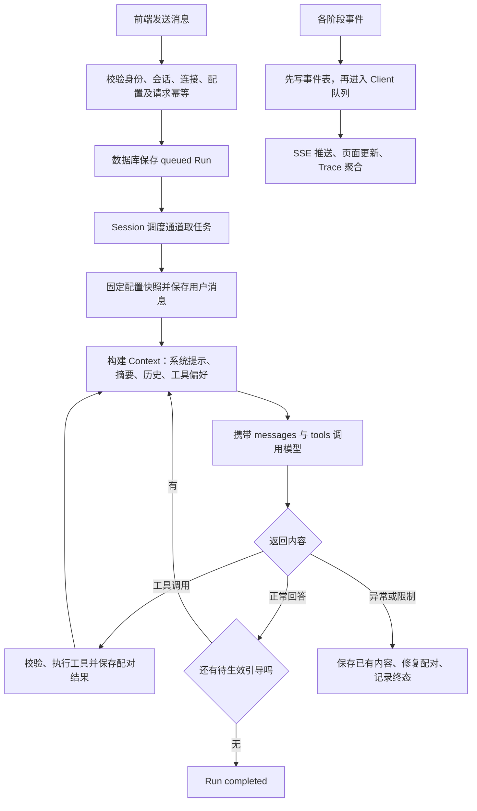

# 三天读懂项目核心链路：后端学习指导路线

作者：LHF。整理日期：2026-10-20。面向毛毛，每天 3–4 小时，目标是能读懂并修改代码。

本文件是项目唯一完整的三天指导路线，覆盖 BaseTool 重构、@工具偏好、思考模式与流式解析，替换原每天 8 小时的旧路线。表中给出文件、精读行段和符号；后续代码变化时优先搜索符号名。完整定位见 [源码与测试符号索引](backend_source_index.md)，快速选读见 [核心链路导航](core_chains_3days.md)。

## 1. 总体脉络：围绕一个 Run 看项目



事件贯穿整个流程，图中的事件支线不是仅在任务结束后执行。HTTP 用于提交和查询；持续输出走已经建立的 SSE 连接。

### 1.1 先分清数据对象

| 对象 | 负责什么 | 与其他对象的关系 |
| --- | --- | --- |
| User | 数据归属；当前为演示用户 A／B | 拥有多个 Session；不是生产认证 |
| Client | 一个前端事件连接 | 同一用户可有多个；用于推送和断线取消 |
| Session | 一段独立聊天 | 保存 Message、Run 和 Summary；同 Session 串行执行 |
| Run | 一次排队任务 | 绑定 Session 和提交它的 Client；包含多次模型及工具调用 |
| Message | 实际协议历史 | user、assistant、tool；外层元数据记录 run_id、input_kind、reasoning 等 |
| Steering | 对当前 Run 的补充条件 | pending → applied；不另开执行预算 |
| Summary | 历史摘要 | text 加 covered 消息 ID；原始 Message 仍保留 |
| Todo | 用户共享业务数据 | 按 User 归属，跨 Session 共享 |
| Operation | 已提交业务操作的成功凭据 | 以操作 ID 防止重复写入，供中断修复查询 |
| Event | 一步执行发生了什么 | 按用户、Session、Run、调用 ID 关联，供 SSE 和 Trace 使用 |

先记住：**一个 Session 有多个 Run，一个 Run 可多次调用模型，每次模型回复又可包含多个工具调用。**

### 1.2 六个关键区分

- **数据库队列与内存 Task**：queued Run 是数据库记录；`lanes` 和 `executions` 是当前进程中的异步任务。重启后处理遗留状态，不自动重放。
- **messages 与 tools**：系统提示、摘要和历史组成 messages；注册工具的 Schema 单独作为 tools 发送。Schema 同样参与输入预算。
- **模型调用与 Agent Loop**：模型适配器只处理一次请求；Runtime 决定是否执行工具、继续推理或结束。
- **工具偏好与强制执行**：@ 提及产生上下文偏好；模型使用 auto 选择工具，缺少参数可以先询问。
- **界面流与持久化历史**：文本／思考 delta 用于实时展示；完整模型消息随后通过 append 保存。中断时另行保存已收到部分。
- **任务完成与业务成功**：Run completed 表示正常结束了本轮；待办是否写入成功，仍要看实际工具结果和业务记录。

## 2. 八条核心链路与精读代码

每节先顺着流程读一遍，再回头看异常分支。表里的行段是精读范围，不要求一次通读整个文件。

### 2.1 对话：输入怎样变成模型请求和页面回答

**流程**：输入 → 提取工具提及 → POST 消息 → 校验／去重 → 保存 queued Run → 启动会话调度 → 保存用户消息 → 构建 Context → 调用模型 → 保存回复 → 事件通知前端。

| 顺序 | 文件与精读行段 | 看什么 |
| --- | --- | --- |
| 1 | [ChatView.vue](../fronted/src/views/ChatView.vue)，677–697；`submit / onKeydown` | 用户提交与 Enter 如何进入发送函数 |
| 2 | [harness.ts](../fronted/src/api/harness.ts)，344–371；`send` | 检查发送条件、提取提及、构造 content／client_id／request_id／tool_names |
| 3 | [main.py](../backend/app/main.py)，187–190；`send_message` | HTTP 入口委托 Runtime，不在接口中等待最终回答 |
| 4 | [runtime.py](../backend/app/runtime.py)，177–216；`submit` | 归属、连接、请求幂等、工具名与模型配置检查；Run 和请求索引同事务提交 |
| 5 | 同文件，331–377；`_lane / append` | 按 Session 取任务，创建可取消执行 Task；保存消息并发事件 |
| 6 | 同文件，518–647；`_execute` | 当前只看从用户消息到模型回复保存的正常路径 |

**输入／输出**：用户文本和提交标识进入系统；HTTP 先返回 Run，最终文本通过 SSE 到达。Run 是执行记录，Message 才是模型历史中的消息。

**检查理解**：为什么请求已经返回，模型仍能生成？相同 request_id 再次提交会不会创建新 Run？本轮尚未执行的 queued 内容，在哪一步才成为历史 Message？

### 2.2 模型适配：怎样处理回答、思考和工具参数

**流程**：统一调用入口 → 计入模型预算 → 创建调用 ID → 配置流式回调 → SDK 请求 → 按类型聚合片段 → 检查结束标记及工具声明 → 返回 ModelReply。

| 文件与精读行段 | 看什么 |
| --- | --- |
| [runtime.py](../backend/app/runtime.py)，393–482；`_invoke` | 每次尝试计数、model.started、正文／思考增量、失败与重试等待 |
| [llm.py](../backend/app/llm.py)，37–174；`OpenAIModel.complete` | messages、tools、tool_choice=auto；流式／非流式解析；按 index 拼接工具名称和 JSON 参数 |
| [response_parser.py](../backend/app/response_parser.py)，6–58 | native_reasoning、protocol_reasoning、ReasoningParser；展示思考与原生回传字段的区别 |
| [model_protocol.py](../backend/app/model_protocol.py)，7–33 | 思考开关如何适配已知供应商与旧配置 |
| [schemas.py](../backend/app/schemas.py)，120–135 | ToolCall、ModelReply：文本、思考、调用、finish_reason 和 usage |

**关键分支**：暂时性失败可重试，但已产生正文或思考后不自动重试；缺少结束标记不能当作完整流成功。模型返回 length 时，Runtime 拒绝执行该批可能截断的工具参数。

**检查理解**：为什么不能收到半段 JSON 就调用工具？为什么工具追问要保留原生 reasoning_content，而不能拿展示文本替代？重试为什么放在 Runtime？

### 2.3 工具管理：声明、注册、校验与执行

**流程**：定义参数模型 → 继承 BaseTool → 声明元数据与策略 → 实现异步 execute → 注册实例 → 生成 Schema → 模型提出调用 → 注册表严格校验参数 → 工具执行 → 返回结构化结果。

| 文件与精读行段 | 看什么 |
| --- | --- |
| [tools.py](../backend/app/tools.py)，30–52；`BaseTool` | schema 统一生成，execute 为抽象异步契约 |
| 同文件，55–85 | CalculatorTool、SearchTool、TodoTool 如何实现契约 |
| 同文件，88–129；`ToolRegistry` | 实例注册、重名和元数据检查、schemas、is_parallel、execute |
| [schemas.py](../backend/app/schemas.py)，89–117 | 参数类型、额外字段拒绝和 Todo 的跨字段规则 |
| [main.py](../backend/app/main.py)，212–229 | 手动待办读写同样构造 ToolCall，通过注册表执行 |

**关键边界**：注册表不相信模型返回的参数，先 model_validate_json 再执行。未知工具返回稳定错误码。计算器和模拟搜索可并行；同批包含串行工具或未知工具时，整批按顺序处理。async execute 内部的同步计算依然在当前线程运行。

**检查理解**：新增工具需要实现哪些字段和方法？修改某个工具的参数应从哪里入手？为什么工具 Schema 通过校验不等于用户拥有某条待办的权限？

### 2.4 Agent Loop：为什么循环，什么时候退出

**流程**：固定配置快照 → 应用引导 → 构建 Context → 再检查新增引导 → 调用模型 → 检查工具调用 ID → 保存 assistant 消息 → 判断是否执行工具或完成。

| 文件与精读行段 | 看什么 |
| --- | --- |
| [runtime.py](../backend/app/runtime.py)，518–571；`_execute` 前半段 | 配置快照、原请求、上下文与引导竞态处理 |
| 同文件，572–622 | 调用 ID 检查、保存原生思考与工具声明、工具分支、正常回答完成检查 |
| 同文件，623–647 | cancelled／limited／failed、finally 修复与最终状态落库 |
| 同文件，664–780；`_batch` | 整批预算、工具超时、并发限制、错误包装、按调用顺序保存配对结果 |
| [schemas.py](../backend/app/schemas.py)，16–45 | RuntimeSettings 与阈值合法性 |

**分支关系**：有工具调用就执行并进入下一轮，模型能看到结果；无工具调用时检查回答和结束标记，完成前还要锁内检查新引导。工具参数错误可变成 tool 错误结果供模型纠正；模型失败、上下文失败或预算耗尽可能终止 Run。

**检查理解**：一次模型请求结束与整个 Run 结束有什么区别？某个工具失败是否一定使 Run failed？为什么结果要按调用 ID 配对，不能只按工具名称？

### 2.5 上下文管理：保留什么，摘要什么

**流程**：读当前 Session 历史 → 排除 covered → 给消息副本加入工具偏好 → 补兼容字段 → 按完整工具块分组 → 组装 system＋历史摘要＋历史 → 估算用量 → 必要时选择旧块并分批摘要 → 检查结果 → 保存摘要和覆盖 ID。

| 文件与精读行段 | 看什么 |
| --- | --- |
| [context.py](../backend/app/context.py)，31–64；`tokens / tool_groups` | token 估算、工具调用与全部结果不可拆分 |
| 同文件，72–153；`ContextManager.build` | 历史过滤、@偏好、messages 组装、工具 Schema 计数及触发判断 |
| 同文件，155–203 | 保护当前请求和已应用引导，选择保留块与待摘要块 |
| 同文件，205–292 | 按摘要模型容量分块、校验摘要、失败回退、覆盖 ID 原子写入及用量事件 |
| [runtime.py](../backend/app/runtime.py)，484–516；`_compact_manually` | 独立压缩 Run，复用预算和取消机制，不生成额外聊天回答 |
| [token_budget.py](../backend/app/token_budget.py) | 输出空间预留；不等于向供应商发送输出上限 |

输入预算为容量减去输出预留和安全余量。默认达到可用输入预算的 80% 时触发，选择历史时尽量向 50% 目标回落；保护内容和摘要长度可能使最终用量高于该目标。

旧摘要以标注为“历史资料”的 user 消息加入，而非升级为系统指令。covered 表示旧消息已由摘要代表，避免每轮把摘要和同一批原消息重复送入模型；数据库中的完整原历史不删除。

**失败边界**：摘要失败时尽量退回仍能容纳的原输入；原输入已超限则明确停止。手动压缩若无旧历史或没有减少用量，可跳过并保留旧摘要；手动摘要失败会反馈失败。

**检查理解**：信息原来存在哪里，压缩后模型看到什么？为什么当前请求和引导需要保护？tool_calls 与 tool 结果被拆开会怎样？

### 2.6 Session：隔离、调度与视图恢复

**流程**：创建 Session → 检查 User 归属和删除状态 → 按 Session 保存 Run／Message／Summary → 会话调度串行取任务 → 切换或刷新时读取详情快照 → 空闲时允许逻辑删除。

| 文件与精读行段 | 看什么 |
| --- | --- |
| [runtime.py](../backend/app/runtime.py)，121–175 | session、delete_session、configured_models、create_session |
| 同文件，331–359；`_lane` | 每 Session 一条通道；等待执行收尾后才取下一项 |
| [main.py](../backend/app/main.py)，155–185 | 会话列表、创建、删除、详情；active_runs 与持久化快照 |
| [harness.ts](../fronted/src/api/harness.ts)，143–164、309–342 | selectSession、boot、switchUser；当前窗口视图与用户切换 |

聊天历史按 Session 取；待办按 User 取，所以同用户两个会话共享待办但不自动共享聊天。会话切换不等于断线；Client 断线才取消该连接提交的当前及排队任务。会话删除会隐藏并拒绝访问，底层历史证据和用户共享待办继续保留。

**检查理解**：User、Client、Session 三个标识分别解决什么问题？为什么两个会话可并行，同一会话却要串行？一个会话的全部排队任务一定来自同一窗口吗？

### 2.7 持久化、幂等与恢复：防止重复和伪成功

**流程**：请求键去重 Run → 工具操作键去重业务写入 → 事务内检查归属和版本 → 同时保存 Todo 和 Operation → 中断后读取已提交凭据 → 补齐缺失工具结果。

| 文件与精读行段 | 看什么 |
| --- | --- |
| [storage.py](../backend/app/storage.py)，16–67 | records／events 两张表；单进程写锁和 transaction |
| 同文件，69–109 | get／put／list；kind、owner、parent 如何组织记录 |
| [tools.py](../backend/app/tools.py)，218–273；`_todo` | 幂等凭据、User 归属、expected_version、业务和凭据同事务提交 |
| [runtime.py](../backend/app/runtime.py)，177–216 | 请求键：request:user:client:request_id |
| 同文件，782–813；`repair_calls` | 查成功凭据补结果；不能证明成功时补未确认结果，不重新执行 |
| 同文件，74–91；`initialize` | 重启后 queued 取消、其他未终态任务中断，不自动恢复执行 |

| 机制 | 防什么 | 主要标识 |
| --- | --- | --- |
| 请求幂等 | 同一提交因网络重试创建两个 Run | user_id、client_id、request_id |
| 操作幂等 | 同一次工具写入重复改变业务 | Agent：op:run_id:tool_call_id；手动：manual:user:Idempotency-Key |
| 版本检查 | 两个调用方持有旧状态并相互覆盖 | todo_id、expected_version |

**检查理解**：已经写入成功但还没回传结果时停止，会发生什么？为什么重启后不能简单重跑所有 running 任务？进程内写锁为什么不能当作多实例分布式锁？

### 2.8 日志／Trace：还原执行过程

**流程**：各阶段 emit → append_event 提交数据库 → 广播到用户匹配的 Client 队列 → SSE → receive 更新前端 → 按 Run、事件类别和调用 ID 聚合步骤。重连后查询快照，而非靠当前 SSE 连接重放所有历史。

| 文件与精读行段 | 看什么 |
| --- | --- |
| [runtime.py](../backend/app/runtime.py)，98–111；`emit` | 事件归属、先落库再广播、有界队列和慢消费者处理 |
| [storage.py](../backend/app/storage.py)，116–162 | append_event、history_events；排序、用户过滤和最近记录限制 |
| [main.py](../backend/app/main.py)，106–144 | Client 创建、SSE ready、心跳、事件输出与断线 finally |
| [harness.ts](../fronted/src/api/harness.ts)，198–307 | receive、connect；正文／思考流、事件筛选、重连和状态恢复 |
| [chat-presentation.ts](../fronted/src/lib/chat-presentation.ts)，190 起；`traceSteps` | 按 Run、事件类别和调用 ID 合并开始／结束，过滤逐字流噪声 |
| [TracePanel.vue](../fronted/src/components/TracePanel.vue) | 聚合后步骤如何分页、展开和显示原始事件 |

本项目的执行追踪主要是 SQLite 结构化事件与页面 Trace。model.delta 等也是事件，但链路视图会过滤逐字噪声；完整回答另存 Message。按 session_id 找会话，再按 run_id 看执行；模型步骤 call_id 来自 _invoke，工具步骤 call_id 对应模型的工具调用 ID。

**检查理解**：一次 model.finished 是否能证明 Run completed？从 tool.finished 的 ok=false 怎样追到参数和前后步骤？刷新后为什么仍能看到历史结果？

## 3. 三天跟读安排

每天采用：**先预测 → 按函数追踪 → 记录输入输出和持久化变化 → 对照测试断言 → 脱离代码复述**。以下是有效学习时间，休息另计。练习以纸上追踪为主；先不改项目代码。

### 第一天：走通正常链路（210 分钟）

| 时间 | 阅读顺序与任务 | 提交物／检查点 |
| --- | --- | --- |
| 20 分钟 | 阅读第 1 节，对照 schemas、Runtime 初始化 | 画出 User → Session → Run → Message，旁边标出 Client 和 Event |
| 50 分钟 | 第 2.1 节：send → send_message → submit → _lane → append | 写下 HTTP 请求字段、返回的 Run、用户消息实际落库时机；解释数据库队列与内存调度 |
| 60 分钟 | 第 2.2、2.3 节：_invoke → complete → ModelReply；BaseTool → register → execute | 分清 messages 与 tools；写一个 read_docs 工具的纸上契约：参数、元数据、策略和异步 execute |
| 60 分钟 | 第 2.4 节正常分支，配合 test_tool_loop_followup_and_session_isolation | 追踪“计算 6×7 并记入待办”，列出每条消息、工具结果和循环条件 |
| 20 分钟 | 不看代码复述正常流程，再回代码纠正 | 讲清 Run、单次模型请求、单个工具调用的边界 |

**预期消息台账**（一种有效的模型选择，不是强制的调用次数）：

| 步骤 | 新增协议消息 | 谁负责 | 下一轮能看到什么 |
| --- | --- | --- | --- |
| 1 | user：计算 6×7 并记入待办 | _execute → append | 用户目标 |
| 2 | assistant：calculator 调用，参数 expression 为 6*7 | complete 返回，_execute 保存 | 调用声明 |
| 3 | tool：对应 calculator 调用 ID，结果为 42 | _batch → registry.execute → append | 用户目标、调用和真实结果 |
| 4 | assistant：todo add 调用，title 使用计算结果 | 模型在下一次调用中生成 | 有依据的写入参数 |
| 5 | tool：todo 写入成功，包含实际待办 ID 和版本 | TodoTool → _todo，_batch 回填 | 已确认业务操作 |
| 6 | assistant：最终回答 | _execute 保存并检查引导后完成 | 本轮完整历史 |

**当天验收**：能沿上述六步定位代码；能解释为什么第二个工具应使用第一个工具的真实结果；能指出新增工具只需实现契约并注册，不必新增 Runtime 名称分支。这里指执行分发；新增有特殊副作用或取消语义的工具，仍应评估调度策略和恢复机制。

### 第二天：历史与数据边界（200 分钟）

| 时间 | 阅读顺序与任务 | 提交物／检查点 |
| --- | --- | --- |
| 70 分钟 | 第 2.5 节：tokens／tool_groups → build 的组装、选择、提交；再看手动压缩 | 画出完整 Message、Summary、covered、模型实际输入四者关系；标注被保护的请求和引导 |
| 45 分钟 | 第 2.6 节：session → _lane → session_detail → selectSession | 画用户 A 两窗口、两个 Session，再加用户 B；标明聊天和待办归属 |
| 55 分钟 | 第 2.7 节：submit 请求事务 → registry → _todo 事务 → repair_calls | 对比请求幂等、操作幂等和版本冲突，写下各自读取／写入的记录 |
| 30 分钟 | 阅读当天测试的准备、动作与断言 | 选摘要覆盖、重复操作、版本冲突三个测试，各写一条“它证明了什么” |

**纸上练习**：旧消息 M1–M6 已被摘要覆盖，M7–M10 保留，M11 是当前请求。写出下一轮模型输入组成；再让 M8 为 assistant 工具调用、M9 为对应结果，说明为何只能整块保留或摘要。给 M11 加上 @todo，标注偏好加入副本的时机，以及原始 Message 是否改变。

**当天验收**：能解释 covered 防重复、原历史不删除、摘要失败回退边界；能判断相同请求再次提交、同一操作再次写入、两窗口同时修改同一版本分别发生什么。

### 第三天：运行控制与排错（200 分钟）

| 时间 | 阅读顺序与任务 | 提交物／检查点 |
| --- | --- | --- |
| 55 分钟 | steer → steer_queued → _apply_steering → _execute 完成前检查 | 区分普通消息入队与绑定当前 Run 的引导；说明转换为何不会双重执行 |
| 55 分钟 | cancel → _cancel_locked → disconnect → _batch 取消处理 → repair_calls；再读 _invoke 重试 | 画 queued／running／cancelling 与终态关系；标记取消时已提交的写入证据 |
| 50 分钟 | emit → append_event → SSE → receive → traceSteps | 画一条事件的字段和去向；区分数据库事件、实时增量、最终 Message |
| 40 分钟 | 用下面三种情景对照代码及测试复述 | 输出故障台账，每行写现象、状态、数据保留、定位函数 |

| 情景 | 必须推演的行为 | 代码入口 |
| --- | --- | --- |
| 最终文本输出中收到引导 | 已完成的这次模型输出可以保存，但 Run 仍需应用引导继续；引导不刷新预算 | runtime.py：225–242、379–391、_execute 的完成检查 |
| todo 已提交、结果尚未回填时停止 | 等待在途写入结算或按操作凭据恢复，不能把已确认写入虚报为未执行；原调用仍有配对结果 | runtime.py：299–309、664–780、782–813 |
| 模型 429 或输出后断流 | 可重试失败遵守次数、模型预算、剩余总时长和 Retry-After；已有正文或思考时不自动重试 | runtime.py：393–482；llm.py 的错误分类 |

第三天的控制函数全部在 [runtime.py](../backend/app/runtime.py)：steer 225–242、steer_queued 253–297、cancel／_cancel_locked 244–251／299–309、disconnect 311–329、_apply_steering 379–391。它们是不同操作入口，不是每次请求都会依次调用的一条直线。

**当天验收**：面对任一情景，能沿 Session → Run → call_id 解释实际发生了什么、哪些状态已持久化、如何确认业务是否成功，以及应在哪段代码修改行为。

## 4. 测试对照与验收方式

以下均为已有离线用例的阅读入口；本轮文档整理没有重新运行它们。学习时先看 fixture 如何创建临时数据库、ScriptedModel 或 MockTransport，再看动作和断言。

| 日期 | 文件／关键测试 | 它主要证明什么 |
| --- | --- | --- |
| 第一天 | [test_runtime.py](../backend/tests/test_runtime.py)：test_direct_reply_and_request_deduplication、test_tool_loop_followup_and_session_isolation | 正常回复、去重、工具结果回到模型、会话历史隔离 |
| 第一天 | [test_tools.py](../backend/tests/test_tools.py)：test_registered_subclass_executes_without_registry_branch_changes、test_base_tool_contract_and_registration_guards | BaseTool 契约、新工具注册后统一分发、非法注册拒绝 |
| 第一天 | [test_response_features.py](../backend/tests/test_response_features.py)：test_missing_tool_parameters_allow_clarification、test_selected_tool_preference_and_results_feed_followup | 工具偏好进入模型输入；脚本模型选择澄清时 Runtime 允许完成，不强制调用 |
| 第二天 | [test_context.py](../backend/tests/test_context.py)：test_compaction_coverage_and_pinned_request、test_summary_failure_keeps_original_and_stops_when_over_limit | covered、当前请求保护、偏好保留和压缩失败边界 |
| 第二天 | [test_manual_compaction.py](../backend/tests/test_manual_compaction.py)：test_manual_compaction_below_threshold_preserves_last_turn_and_history、test_longer_summary_is_not_committed | 手动压缩保护最近轮次、完整历史保留、无收益不覆盖 |
| 第二天 | [test_tools.py](../backend/tests/test_tools.py)：test_todo_transaction_idempotency_user_isolation_and_version；[test_api.py](../backend/tests/test_api.py)：test_manual_todos_use_the_same_tool_registry | 业务幂等、用户与版本边界、手动入口统一分发 |
| 第三天 | [test_runtime.py](../backend/tests/test_runtime.py)：test_final_answer_steering_remains_in_current_task、test_queued_message_can_be_atomically_promoted_to_current_run、test_manual_stop_advances_queue_but_disconnect_cancels_it | 引导归属与预算、原子转换、停止与断线差异 |
| 第三天 | [test_recovery.py](../backend/tests/test_recovery.py)：test_cancel_during_committed_write_preserves_result、test_restart_marks_runs_and_recovers_committed_tool_result | 取消与已提交写入结算、重启状态修复 |
| 第三天 | [test_llm.py](../backend/tests/test_llm.py)：test_sdk_rate_limit_classified_without_hidden_retries、test_stream_without_finish_marker_fails | SDK 关闭隐式重试、限流分类、流完整性 |

可选的自行验证命令，工作目录为项目根目录；不会启动服务，不需要真实模型 Key：

```powershell
Push-Location .\backend
try {
    # 作用：只运行明确的离线用例；下面每条分别对应一天。
    .\.venv\Scripts\python.exe -m pytest tests/test_runtime.py tests/test_tools.py tests/test_response_features.py -q
    .\.venv\Scripts\python.exe -m pytest tests/test_context.py tests/test_manual_compaction.py tests/test_tools.py tests/test_api.py -q
    .\.venv\Scripts\python.exe -m pytest tests/test_runtime.py tests/test_recovery.py tests/test_llm.py -q
} finally {
    Pop-Location
}
```

不把脚本模型的指定返回当作真实模型一定会做出的选择；MockTransport 证明协议处理，不证明供应商实际可用；临时数据库测试不证明多实例部署或真实浏览器联调。

## 5. 三天后的成果与修改定位

最终保留四份学习成果：一张正常请求时序图、一张对象与归属图、一个 Context 压缩前后对照表、一份异常台账。每天的纸上记录可以合并，不要求额外生成大量文件。

| 后续需求／问题 | 先查哪里 |
| --- | --- |
| 新增工具或改变参数 | schemas 参数模型 → BaseTool 子类 → ToolRegistry 注册与调用 |
| 调整 @工具偏好 | 前端 mentionedTools／send → 消息 tool_names → ContextManager.build |
| 调整压缩时机、保护内容或摘要提示 | RuntimeSettings → ContextManager.build → 手动压缩入口 |
| 对话顺序、引导或排队不对 | submit／_lane → steer_queued／_apply_steering → _execute 完成检查 |
| 重试、超时或预算行为不对 | _invoke／_batch／_execute，连同 ModelFailure 的分类 |
| 工具显示成功但业务不确定 | tool.finished 与 tool Message → Todo／Operation → repair_calls |
| 页面刷新后历史或 Trace 不对 | session_detail／history_events → selectSession／receive → traceSteps |

合格标准：不看代码讲清完整请求链路；给定一个修改能定位入口并说明上下游影响；给定一次失败能通过状态、事件、工具结果及业务凭据判断原因。遇到答不清的问题，记录“具体函数＋输入＋当前理解＋疑问”，回到该链路补读。

本路线以代码阅读、纸上追踪和已有离线用例为主。学习练习不要求启动服务或调用真实模型，运行测试由毛毛自行选择；发布和验证情况单独记录在 [实施与验证记录](verification.md)。
